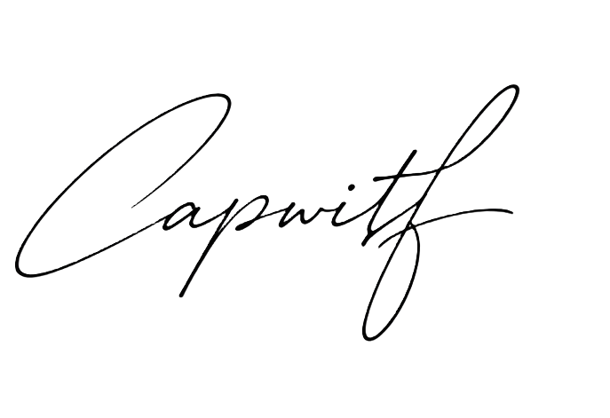

<p align="center">
  
</p>

<h1 align="center">Write Readme</h1>

<p align="center">
  A Codex skill for creating and polishing GitHub README files with a clean project-homepage structure.
</p>

<p align="center">
  <a href="#中文"></a>
  <a href="#english"></a>
  
  
</p>

<p align="center">
  
  
  
</p>

## 中文

`write-readme` 帮你把仓库首页整理成更像成熟开源项目的 README：标题清楚、价值一句话说透、预览和用法靠前，下载、贡献、许可证和联系信息放在合适的位置。

## 适合处理

- 从零创建 README
- 重写或精简已有 README
- 调整中英文 README 结构
- 同步项目名、安装命令、下载链接、发布链接
- 增加截图、预览、FAQ、贡献、许可证和联系信息

## 结构特点

- 参考 React、Next.js、Vite、shadcn/ui 等高星仓库的组织方式
- 默认保留顶部语言导航和清晰的章节层级
- 每份 README 默认在顶部加入紧凑徽章行，至少包含真实的 Markdown 格式徽章
- 区分库、应用、CLI、Codex skill 等不同项目类型
- 避免伪造徽章、命令、截图、下载地址和兼容性声明
- 在仓库地址已知时，使用 shields.io 动态同步 stars、forks、issues、pulls、release、downloads 等徽章
- 如果需要同步 GitHub 统计但缺少 `OWNER/REPO`，会提醒你提供仓库路径
- 从真实项目文件识别技术栈，并生成语言、框架、运行时、包管理器、平台等技术栈徽章
- 如果需要技术栈徽章但无法确认技术栈，会提醒你补充信息
- 支持把用户指定的联系方式与签名放在 README 底部

## 动态徽章模板

把 `OWNER/REPO` 替换成真实 GitHub 仓库路径后，下面这些徽章会自动同步仓库数据：

```markdown
<p align="center">
  <a href="https://github.com/OWNER/REPO/stargazers">
    
  </a>
  <a href="https://github.com/OWNER/REPO/network/members">
    
  </a>
  <a href="https://github.com/OWNER/REPO/issues">
    
  </a>
  <a href="https://github.com/OWNER/REPO/pulls">
    
  </a>
</p>
```

## 技术栈徽章模板

确认项目真实技术栈后，可以加入类似下面的徽章：

```markdown
<p align="center">
  
  
  
  
  
</p>
```

## 安装

将本目录放到 Codex skills 目录中：

```powershell
C:\Users\T\.codex\skills\write-readme
```

或保持当前目录，并在需要时通过路径引用这个 skill。

## 使用

在 Codex 中提出 README 相关任务即可触发，例如：

```text
Use $write-readme to rewrite this repository README.
```

```text
用 $write-readme 优化 README，保留下载链接在底部。
```

## 文件结构

```text
write-readme/
├── SKILL.md
├── README.md
├── agents/
│   └── openai.yaml
├── assets/
│   ├── capwitf.png
│   └── write-readme-logo.svg
└── references/
    └── readme-blueprint.md
```

## 校验

可以使用 Codex 自带的 skill 校验脚本检查元数据：

```powershell
python C:\Users\T\.codex\skills\.system\skill-creator\scripts\quick_validate.py C:\Users\T\Desktop\write-readme
```

## English

`write-readme` helps Codex create or polish repository READMEs that feel like mature GitHub project home pages: clear title, crisp summary, early preview or usage path, and well-placed release, contribution, license, and contact sections.

## Good For

- Creating a README from scratch
- Rewriting or simplifying an existing README
- Structuring bilingual Chinese and English READMEs
- Updating project names, install commands, download links, and release URLs
- Adding screenshots, previews, FAQs, contribution notes, licenses, and contact details

## What It Adds

- README structure inspired by high-star repositories such as React, Next.js, Vite, and shadcn/ui
- Clear section ordering for libraries, apps, CLIs, and Codex skills
- A compact badge row in every README by default, including at least a factual Markdown format badge
- Strong defaults for language links, previews, install commands, usage, releases, and license sections
- Guardrails against invented badges, commands, screenshots, URLs, or compatibility claims
- Dynamic shields.io GitHub badges for stars, forks, issues, pull requests, releases, and downloads when the GitHub `OWNER/REPO` is known
- A reminder to provide the repository path when synced GitHub stats are requested but cannot be resolved
- Technology stack badges for confirmed languages, frameworks, runtimes, package managers, and platforms
- A reminder to provide stack details when tech stack badges are requested but cannot be verified
- Support for user-specified contact details and bottom-centered signature assets

## Contact

Email: [capwitf@outlook](mailto:capwitf@outlook)

<p align="center">
  
</p>

## 许可证

本项目采用 [MIT License](LICENSE)。

## License

This project is licensed under the [MIT License](LICENSE).
